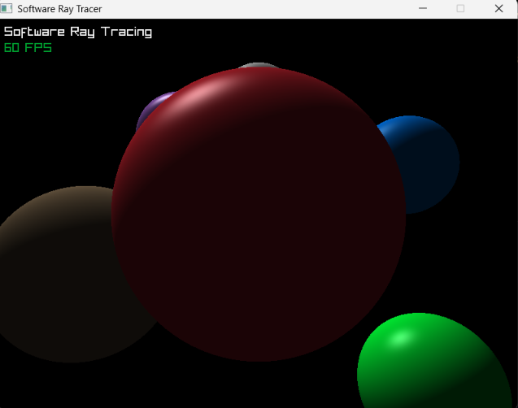

# raytracer-c

Ray tracer em software escrito em C com [raylib](https://www.raylib.com/).

A cena é renderizada pixel a pixel na CPU: para cada pixel, um raio sai da câmera, é testado contra as esferas e a cor final é calculada com iluminação **difusa (Lambert)** e **especular (Phong)**. O resultado vai para um buffer RGBA e é exibido como textura.



## Recursos

- 6 esferas com materiais diferentes (cor, intensidade do brilho e shininess)
- Luz direcional (sol)
- Iluminação ambiente + difusa + especular (brilho em branco)
- Sombras projetadas pelas esferas (raios de sombra)
- Chão com padrão xadrez
- Renderização única da cena, com a imagem exibida a 60 FPS

## Como compilar

Requisitos: GCC e raylib. No Windows, usando o terminal **MSYS2 UCRT64**:

```bash
pacman -S mingw-w64-ucrt-x86_64-gcc mingw-w64-ucrt-x86_64-raylib
gcc raytracer.c -o raytracer.exe -O2 -lraylib -lopengl32 -lgdi32 -lwinmm
./raytracer.exe
```

A janela pode levar alguns segundos para abrir, que é o tempo de calcular a imagem.

> Alguns antivírus marcam `.exe` recém-compilados como suspeitos (falso positivo). Se o executável sumir, confira a quarentena ou adicione a pasta do projeto às exclusões.

## Como funciona

1. `GetScreenToWorldRay` gera o raio da câmera para cada pixel.
2. `GetRayCollisionSphere` testa a colisão com cada esfera, e o código também testa o plano do chão, guardando o objeto mais próximo.
3. Com a normal e o ponto de impacto, calcula-se:
   - **Difusa:** produto escalar entre a normal e a direção inversa da luz
   - **Especular:** `(visão · reflexão)^shininess × força do material`
4. Um raio de sombra parte do ponto de impacto em direção à luz; se uma esfera bloquear o caminho, só resta a luz ambiente.
5. As cores são combinadas, limitadas a 0–255 e gravadas no buffer de pixels.

## Próximos passos

- [x] Sombras
- [x] Plano de chão com padrão xadrez
- [ ] Reflexões (raios recursivos)
- [ ] Raios calculados manualmente + OpenMP para câmera em tempo real
